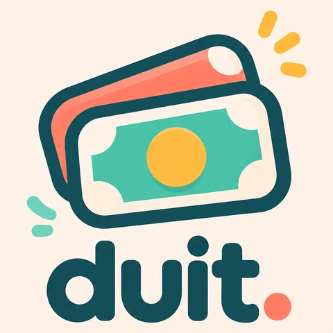
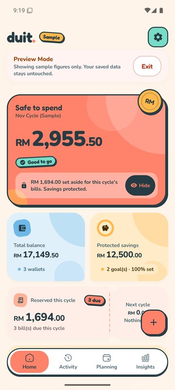
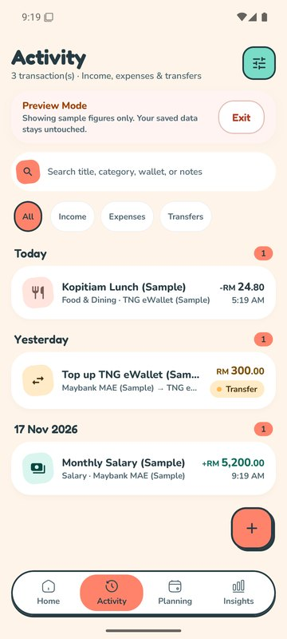

  

<h1 align="center">duit.</h1>

<b>Your money, made simple.</b>

  
  
  
  

duit. is a friendly, private money app for Android. Track your wallets, see what is safe to spend, plan for bills and savings, and understand where your money goes, all on your own phone.

  
  
  
  

Screenshots use duit.'s built-in sample data.

## Features

- **Wallets**: cash, bank, e-wallet and savings, with income, expenses and transfers.
- **Safe to Spend**: what is free to use after this cycle's bills and your protected savings.
- **Savings goals**: targets, progress and optional dates.
- **Budgets**: limits for the whole month or a category, with warnings at 80% and 100%.
- **Bills, PayLater and debts**: due dates, instalments and payments in one place.
- **Commission tracking**: sales, gross profit and payouts.
- **Insights**: income, spending, categories and trends.
- **Reminders**: bills, budgets and savings, with amounts hidden on the lock screen if you choose.
- **Home screen widgets**: Safe to Spend, Wallets, Quick Add, Savings Goal and more.
- **App Lock and Privacy Mode**: a 6-digit PIN, fingerprint unlock and one tap to hide amounts.
- **Backup and restore**: password-protected backup files, plus CSV export.
- **Optional Commission Tracking**: sales, commission and payouts for people paid by commission. Off by default; turn it on in Settings → Optional Features.
- **Help Centre and feedback**: quick guides, plus a form to report bugs or suggest features.

## Privacy and offline-first

- Your records are stored only on your phone. There is no account and no cloud sync.
- duit. connects to the internet only to check GitHub for app updates.
- Android cloud backup is turned off for duit., so your financial data does not leave your phone that way. Use **Settings > Backup & Restore** to make your own password-protected backup.
- CSV exports are not encrypted. Keep them somewhere safe.
- Feedback you choose to send goes to the developer through Google Apps Script and a private Google Sheet.
- Read the full [Privacy Policy](PRIVACY.md).

## Download and install

1. Open the [latest release](https://github.com/erlingdiniy/duit-beta/releases/latest) on your Android phone.
2. Download the `duit-x.y.z.apk` file under **Assets**.
3. Open it. If Android asks, allow your browser or file manager to install apps.
4. Optional: compare the file's SHA-256 checksum with the one in the release notes.

**Requirements:** Android 10 or later.

## Updates

duit. checks this page for new releases when you open it, or when you tap **Settings > About > Check for updates**. When an update is ready you will see what's new and can choose **Update Now** or **Maybe Later**. Each download is checked against its published checksum and signature, and Android always asks you to confirm before installing. Your data is kept.

Using duit. Beta? Update from inside the app. Beta 0.1.0-beta.5 and later will offer the stable release.

## Changelog

| Version | Date | Highlights |
| --- | --- | --- |
| [1.1.0](https://github.com/erlingdiniy/duit-beta/releases/tag/v1.1.0) | 19 Nov 2026 | Help Centre, feedback, privacy page, optional commission tracking, Support duit. |
| [1.0.0](https://github.com/erlingdiniy/duit-beta/releases/tag/v1.0.0) | 19 Nov 2026 | First stable release |
| [0.1.0-beta.5](https://github.com/erlingdiniy/duit-beta/releases/tag/beta-5) | 19 Nov 2026 | Prepares beta apps for the stable release |
| [0.1.0-beta.4](https://github.com/erlingdiniy/duit-beta/releases/tag/beta-4) | 19 Nov 2026 | Clearer update notes, "Update Now" and "Maybe Later" |
| [0.1.0-beta.3](https://github.com/erlingdiniy/duit-beta/releases/tag/beta-3) | 19 Nov 2026 | Candy update popup and welcome screen |

See all [releases](https://github.com/erlingdiniy/duit-beta/releases) for full notes.

## Feedback and bug reports

Found a bug or have an idea? Use **Settings → Help & Feedback** in the app, or [open an issue](https://github.com/erlingdiniy/duit-beta/issues). Include your Android version, your duit. version (**Settings > About**) and the steps to reproduce. Never include your PIN, backup password or real financial details.

## Credits

Made with care by erlingdiniy. Enjoying duit.? You can support it with a coffee from **Settings → Support duit.** (100% optional). App fonts: Fredoka and Nunito, under the SIL Open Font License.

duit. is distributed as an APK through GitHub Releases. The source code is not published here.

