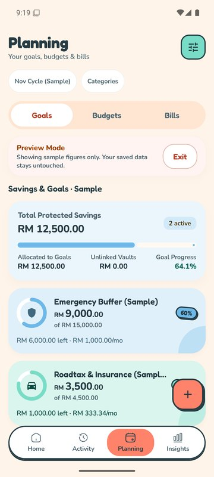
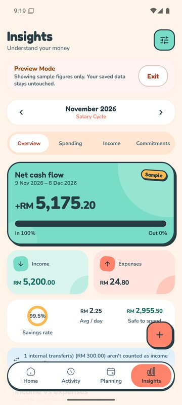

  

<h1 align="center">duit.</h1>

<b>Your money, made simple.</b>

  
  
  
  

`duit.` is a friendly, local-first personal finance app for Android. Track your wallets, see what is safe to spend, plan for bills and savings, attach receipts privately, and understand where your money goes—all on your own phone.

This repository (`erlingdiniy/duit-beta`) hosts official signed APK releases and in-app updates. The open-source Android project lives at [`erlingdiniy/duit`](https://github.com/erlingdiniy/duit).

  
  
  
  

Screenshots use duit.'s built-in sample data.

## Features

- **Wallets & Exact Integer Accounting:** Cash, bank, e-wallet, and savings wallets with income, expenses, transfers, and Quick Action.
- **Safe to Spend:** What remains free to spend after this cycle's bills and your protected savings.
- **Dual Themes:** **Candy Bubble 2.0** (Light & Dark) and **Pure Liquid Glass** (Light & Dark, LOW/MID/HIGH intensity).
- **Planning Tools:** Savings Goals, Budgets (80% / 100% alerts), Bills, PayLater & Debts, Savings Challenges, Smart Money Calendar, My Tax Pocket, and Little Wins Club.
- **Receipt Vault:** Private local PDF/JPG/PNG receipt storage included inside encrypted backups.
- **Insights & Money Personality:** Income, spending trends, category breakdowns, and shareable personality card.
- **Optional Commission Tracking:** Sales, gross profit, and payouts (off by default; toggle in Settings -> Optional Features).
- **12 Home Screen Widgets:** Balance, Wallets, Quick Add, Savings Goals, Upcoming Payments, Budgets, Pulse, Payday, Summary, Commitments, Buddy, and Privacy toggle.
- **App Lock & Privacy Mode:** 6-digit PIN (PBKDF2 + Android Keystore), biometric unlock, screenshot blocking, and one-tap Privacy Mode.
- **Encrypted Backup & Restore:** Password-protected AES-256-GCM `.duitbackup` archives with staged atomic restore, plus CSV export.

## Privacy and local-first design

- Your wallets, transactions, budgets, goals, and attached receipts stay on your phone. There is no account and no cloud sync.
- Public builds (`com.diniy.duit.beta`) connect online only for GitHub update checks, optional feedback you choose to submit, and FCM Developer Broadcasts announcements (with Firebase Analytics and ADID disabled).
- Android auto-backup is turned off (`android:allowBackup="false"`). Use **Settings -> Backup & Restore** for password-protected `.duitbackup` files.
- CSV exports are plain unencrypted spreadsheets.
- Read the full [Privacy Policy](PRIVACY.md).

## Download and install

1. Open the [`v1.2.0-beta.2` pre-release](https://github.com/erlingdiniy/duit-beta/releases/tag/v1.2.0-beta.2) on your Android device (earlier `1.1.0`, `1.1.1`, and `1.2.0-beta.1` APKs were withdrawn to remove personal QR data).
2. Download `duit-1.2.0-beta.2.apk` under **Assets**.
3. Open the APK and confirm installation when Android prompts.
4. *(Recommended)* Compare the SHA-256 checksum against the release notes before installing.

**Requirements:** Android 10 (API 29) or later.

## Updates

`duit.` checks this repository for new releases automatically and via **Settings -> About -> Check for updates**. Every downloaded update is verified against its published SHA-256 digest and signing certificate before Android asks you to confirm installation.

## Feedback and bug reports

Use **Settings -> Help & Feedback** inside the app, or open an issue on [`erlingdiniy/duit`](https://github.com/erlingdiniy/duit/issues). Never share personal financial balances, PINs, backup passwords, or unredacted screenshots publicly.

## Credits

Made by `erlingdiniy` and released under the [Apache License 2.0](https://github.com/erlingdiniy/duit/blob/main/LICENSE). Bundled fonts (**Fredoka** and **Nunito**) are licensed under the SIL Open Font License 1.1. Voluntary donations under **Settings -> Support duit.** are temporarily unavailable.
