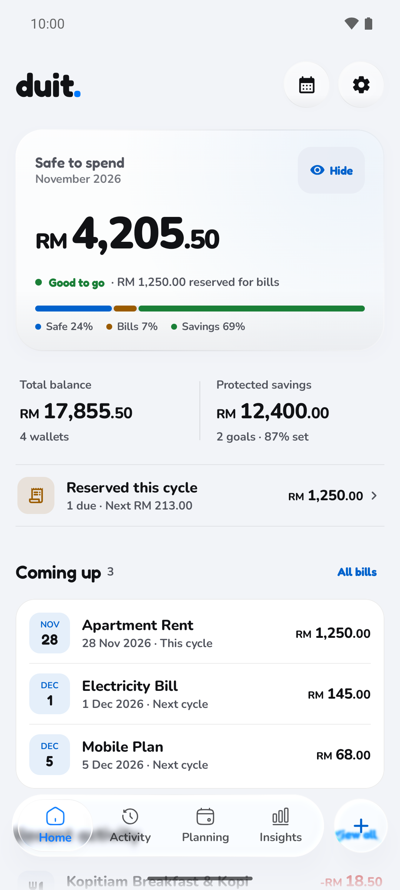
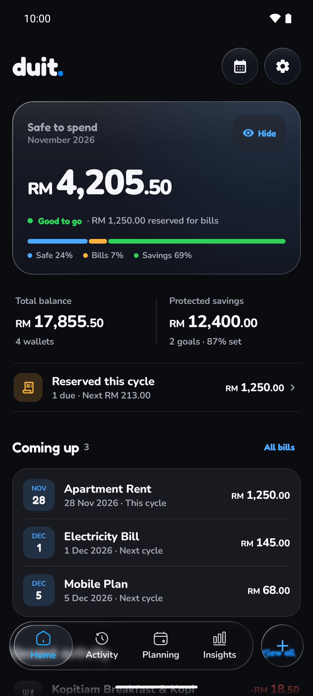
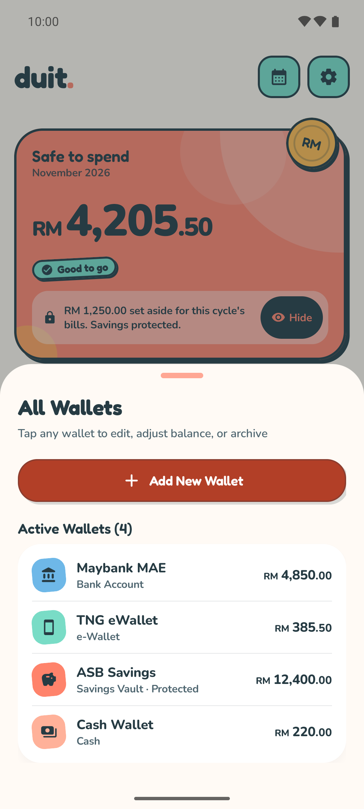
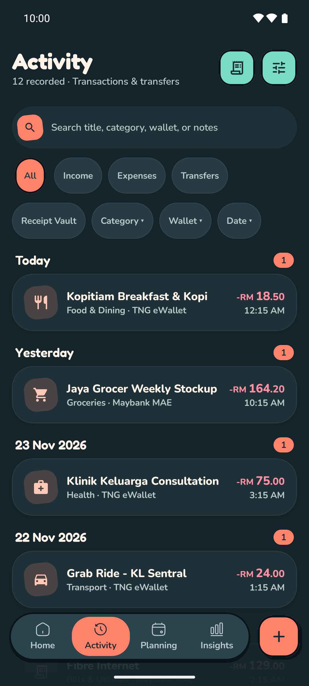
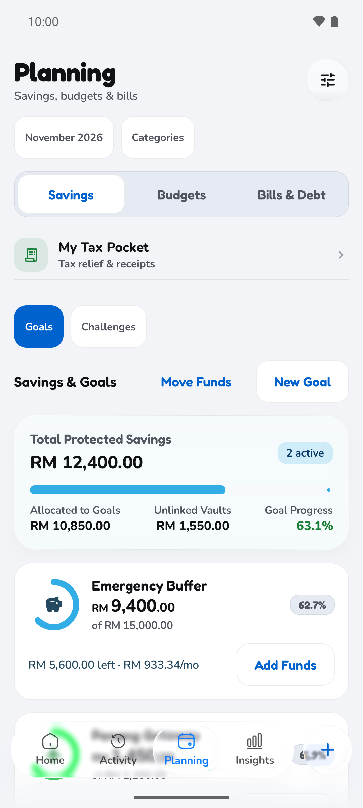
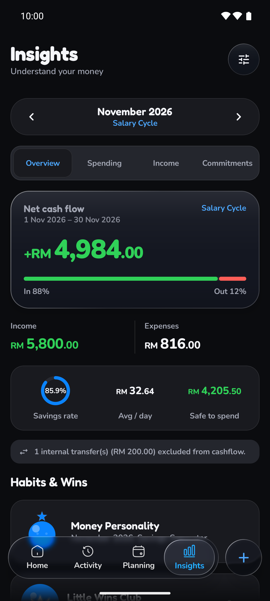
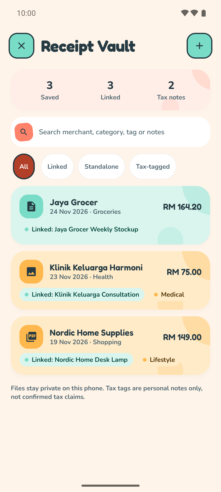
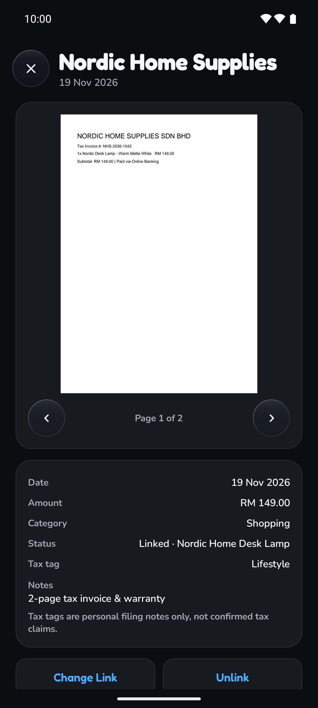

  

<h1 align="center">duit.</h1>

<b>Your money, made simple.</b>

  
  
  
  

duit. is a friendly, private, open-source personal finance app for Android. Track your wallets, see what is safe to spend, attach local receipts, plan for bills and savings goals, and understand where your money goes—all on your own phone.

  
  
  
  

  
  
  
  

Screenshots use isolated synthetic demo data — no private user financial data or receipts are included.

## Features

- **Pure Liquid Glass & Candy Bubble 2.0:** Choose between translucent frosted optics with selectable **LOW / MID / HIGH** glass intensity (AGSL optics on Android 13+, RenderEffect blur on Android 12, translucent fallback on Android 10–11) or pastel Candy Bubble 2.0, in both **Light** and **Dark** modes.
- **Wallets & exact integer accounting:** Cash, bank, e-wallet, and savings accounts stored in integer *sen* (`Long`) with income, expenses, and transfers.
- **Safe to Spend:** Shows what remains free in your active salary cycle after reserving upcoming bills and protected savings.
- **Planning tools:** **Savings Goals**, **Budgets** (overall & category with 80% / 100% alerts), **Bills, PayLater & Debts**, **Savings Challenges**, **Smart Money Calendar**, **My Tax Pocket**, and **Little Wins Club**.
- **Receipt Vault:** Store private local PDF, JPG, and PNG receipts (up to `10 MB` per file) with in-app multi-page PDF and photo previews, linked transactions, and optional tax tags.
- **Insights & Money Personality:** Income vs. spending breakdown, spending pace, and a shareable summary PNG card.
- **12 Home Screen Widgets:** Glance widgets for Safe to Spend, Wallets, Quick Add, Savings Goals, Budgets, Upcoming Payments, Privacy Mode, and more.
- **App Lock & Privacy Mode:** 6-digit PIN (salted PBKDF2 with Android Keystore), biometric unlock, screenshot blocking (`FLAG_SECURE`), and one-tap amount masking.
- **Encrypted backup & restore:** AES-256-GCM `.duitbackup` archives preserving financial records and Receipt Vault attachments (`12 MB` raw receipts / `32 MB` backup file cap), plus plaintext CSV export.
- **Optional Commission Tracking:** Track sales, gross profit, and payouts (off by default in public builds; toggle in **Settings -> Commission Tracking**).
- **Help Centre & feedback:** Offline guides plus an opt-in feedback form to report bugs or request features.

## Privacy and offline-first

- **Local storage only:** Your wallets, transactions, goals, budgets, commitments, and receipts stay on your device. There is no account and no cloud sync.
- **Android auto-backup disabled:** `android:allowBackup="false"` keeps your local Room database and receipts off Android Google Drive backups.
- **No ads or analytics:** Firebase Analytics and advertising ID collection are disabled in all public builds.
- **Limited network calls (only three):**
  1. Checking GitHub Releases (`erlingdiniy/duit-beta`) for app updates. Stable `v1.2.0` ignores pre-release tags.
  2. Sending opt-in feedback you submit from **Settings -> Help & Feedback** via Google Apps Script (`feedback-backend/Code.gs`) — never balances, transactions, or receipts.
  3. Receiving optional **Developer Broadcasts** announcements via Firebase Cloud Messaging channel topics (`duit_announcements` on Stable, `duit_beta_broadcasts` on Beta) without uploading tokens or financial data.
- Read the full [Privacy Policy](PRIVACY.md).

## Download and install

1. Open the [latest release](https://github.com/erlingdiniy/duit-beta/releases/latest) (`v1.2.0`) on your Android device.
2. Download **`duit-1.2.0.apk`** under **Assets**.
3. *(Recommended)* Verify the downloaded APK SHA-256 checksum against the hash published in [the release notes](RELEASE_NOTES_v1.2.0.md).
4. Tap the APK to install. If Android asks, allow your browser or file manager to install unknown apps.

**Requirements:** Android 10 (API 29) or higher (AGSL Liquid Glass refraction requires Android 13+ / API 33+).

## Updates

duit. checks this repository's Releases when opened or when you tap **Settings -> About duit. -> Check for updates**. Stable installs (`1.2.0`) track only stable releases and ignore pre-release beta builds. Downloads are verified against both their published SHA-256 digest and signing certificate before Android prompts you to install, keeping all existing data and receipts intact.

Upgrading from `1.1.1` (`1001001`), `1.2.0-beta.1` (`1001901`), or `1.2.0-beta.2` (`1001902`) upgrades seamlessly in-place.

## Changelog

| Version | Date | Highlights |
| --- | --- | --- |
| [1.2.0](https://github.com/erlingdiniy/duit-beta/releases/tag/v1.2.0) | 25 Nov 2026 | First v1.2 Stable release: Pure Liquid Glass, Receipt Vault, Smart Money Calendar, My Tax Pocket, Little Wins Club, Savings Challenges, Money Personality, Stable update channel & broadcast topic isolation |
| [1.2.0-beta.2](https://github.com/erlingdiniy/duit-beta/releases/tag/v1.2.0-beta.2) | 23 Nov 2026 | Public beta with Pure Liquid Glass, Receipt Vault, startup/render optimizations & QR-free Support screen |
| [1.1.0](https://github.com/erlingdiniy/duit-beta/releases/tag/v1.1.0) | 19 Nov 2026 | Help Centre, feedback, privacy page, optional commission tracking, Support duit. |
| [1.0.0](https://github.com/erlingdiniy/duit-beta/releases/tag/v1.0.0) | 19 Nov 2026 | First stable release |
| [0.1.0-beta.5](https://github.com/erlingdiniy/duit-beta/releases/tag/beta-5) | 19 Nov 2026 | Prepares beta apps for the stable release |
| [0.1.0-beta.4](https://github.com/erlingdiniy/duit-beta/releases/tag/beta-4) | 19 Nov 2026 | Clearer update notes, "Update Now" and "Maybe Later" |
| [0.1.0-beta.3](https://github.com/erlingdiniy/duit-beta/releases/tag/beta-3) | 19 Nov 2026 | Candy update popup and welcome screen |

See all [releases](https://github.com/erlingdiniy/duit-beta/releases) for full notes.

## Feedback and bug reports

Found a bug or have an idea? Use **Settings -> Help & Feedback** inside the app, or open an issue on GitHub. Include your Android version, your duit. version (**Settings -> About duit.**), and clear steps to reproduce. Never share your PIN, backup password, or personal financial details.

## Credits & Source Code

Made in Malaysia by **erlingdiniy**. Voluntary donations under **Settings -> Support duit.** are currently unavailable while payment support is paused.  
Source code is open-source under the **Apache License, Version 2.0** in [`erlingdiniy/duit`](https://github.com/erlingdiniy/duit). App fonts: **Fredoka** and **Nunito** under the SIL Open Font License 1.1.
